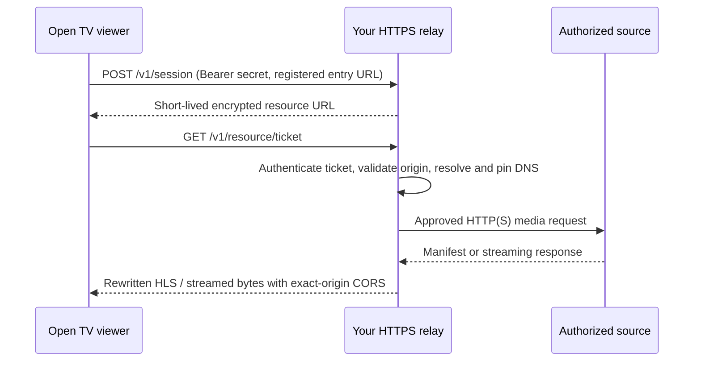

# HTTP media, CORS and an authorized relay

## Hosting

The static interface and JSON catalogs can be served from any static host, while video
comes directly from its authorized host or from your own permitted relay. A CDN's terms
on video and large-file delivery apply to you; a Worker can stream a response, but a free
plan does not authorize an unrestricted video relay. Do not treat a Worker, tunnel or cache
setting as a workaround for a host's terms. Provider embeds use their normal provider
player.

## What each source needs

| Source                                   | What works / what is required                                                                                                                                                                                                                                        |
| ---------------------------------------- | -------------------------------------------------------------------------------------------------------------------------------------------------------------------------------------------------------------------------------------------------------------------- |
| HTTPS MP4/WebM                           | Native video can usually play cross-origin without JS reading pixels; source permissions, codecs, ranges and regional policy still matter                                                                                                                            |
| HTTPS HLS in Safari/native HLS           | Browser/platform transport; manifest, segments, keys, audio and subtitles must all be available                                                                                                                                                                      |
| HLS.js / MSE                             | JavaScript fetches require CORS on manifests, segments, keys and alternate tracks, not only the first URL                                                                                                                                                            |
| HTTP media from an HTTPS app             | Mixed content; JS fetch is blocked. Some native video requests auto-upgrade hostnames, which fails when no HTTPS endpoint exists. IP-literal HTTP is blocked. Use authorized HTTPS or a relay                                                                        |
| HTTP media from an HTTPS app (retry)     | Before failing, Open TV checks whether the same address answers over HTTPS and plays that. An HTTP embed gets the same check. When neither works, a relay (Settings → This device) is the answer. The relay's address is remembered on the device; its secret is not |
| HTTPS manifest referencing HTTP segments | Still mixed content; securing only the manifest is insufficient                                                                                                                                                                                                      |
| HTTP playlists/API/XMLTV                 | Fetching metadata has the same secure-context/CORS constraints. Import a legal local playlist file or use an authorized HTTPS API; the media relay is not an arbitrary API proxy                                                                                     |
| Provider iframe                          | Provider-owned UI, frame policy, cookies and TV control support; cannot generally inspect tracks/progress or override frame restrictions                                                                                                                             |
| DRM / login / region restriction         | Requires the provider's authorized integration. A relay supplies neither a license nor access-control/geography bypass                                                                                                                                               |

## How a media address reaches the player

On an HTTPS page, plain-HTTP media is blocked as mixed content. One resolver
(`src/playback/route.ts`) decides how each media address is played, in this order, and
stops at the first route that works:

1. **Direct.** The address is HTTPS: it plays as is. An HLS playlist that is HTTPS but
   lists HTTP variants, segments, keys or audio/subtitle renditions is still mixed
   content, so it counts as HTTP from here on.
2. **Its HTTPS version.** For an HTTP address, the same host and path over HTTPS (an
   explicit `:80` dropped, any other port kept) is asked for a small piece. It is used
   only when it answers like media. Never rewritten without that check. Skipped for bare
   IP addresses, which have no certificate.
3. **The TV app.** In the Google TV app, the host fetches the address for the page at
   `/__http/<host>/<path>` (or `/__https/…` for an HTTPS playlist with HTTP parts): GET
   only, every redirect re-checked and followed by the host, never this device's
   loopback or link-local addresses, and every reference inside a playlist pointed back
   through the same route.
4. **Your relay.** Only when you configured one (Settings → This device → Playback
   connection), and only for the sources it allows. It rewrites playlists the same way.
5. **Blocked**, with the reason: no HTTPS version answered, a bare IP address with no
   relay, an HTTPS playlist with HTTP parts and no relay, the relay refused the source,
   or an address with a user name or password (never sent anywhere on your behalf).

**The route is remembered** per stream host for 24 hours (`opentv:transport-routes:v1`),
so later plays go straight there, also after a reload. A playback failure on a
remembered route clears it and the resolver runs once more. Settings → This device →
Playback connection lists the remembered routes and can forget them. The player's error
and Stream check say which route was tried, or exactly why it was blocked.

Never routed through an unknown or public proxy; the control relay (Play on TV) never
carries media. A relay supplies transport only: no DRM, login or region bypass. HTTP
playlists, APIs and XMLTV guides are outside this resolver and still need HTTPS
endpoints or a local file. A relay set to "All direct media" is used for every source,
as configured. The Android manifest permits cleartext traffic for the host's fetch;
the WebView itself still cannot load HTTP directly.

## Free or low-cost structures

| Option                                      | Where it fits                                                                 | Limits/tradeoffs                                                                                                                                  |
| ------------------------------------------- | ----------------------------------------------------------------------------- | ------------------------------------------------------------------------------------------------------------------------------------------------- |
| Direct authorized HTTPS with correct CORS   | Best default; no extra Open TV infrastructure                                 | The broadcaster controls availability, permission and region                                                                                      |
| Caddy/Nginx on an existing PC/NAS/server    | Self-hosted HTTPS plus the bundled allowlisted relay                          | Software can be free; hardware, electricity, upload bandwidth and uptime are yours                                                                |
| Tailscale Serve on existing hardware        | Private household/personal access over HTTPS within a tailnet                 | Requires authorized clients and a suitable plan; not a public streaming CDN; browser local-network permissions may apply                          |
| Oracle Always Free compute, if available    | A small relay on a user-controlled VM within free allowances                  | Capacity, idle-resource reclamation, account eligibility and egress quotas apply. Paid upgrades/overages are not approved or enabled by this repo |
| Tailscale Funnel                            | Occasional permitted public sharing                                           | Has non-configurable bandwidth limits; not recommended as a dependable public TV transport                                                        |
| Cloudflare R2/Stream or other media storage | Hosting media you have permission to distribute using the appropriate product | Separate service/terms/quotas; free storage allowances are not an unlimited live HTTP proxy. No account/billing integration was added             |

There is no verified, unlimited, anonymous free public video proxy recommendation.
Random CORS relays can expose credentials and fail without notice. A 4 Mbps stream
uses roughly 1.8 GB per viewer-hour; small free egress quotas disappear quickly.

## Included optional relay

`server/relay.ts` runs with Node 24's built-in TypeScript support and standard
library; it needs no new npm runtime dependency, database, containers or cloud
services. It binds only `127.0.0.1`. Put an authorized HTTPS endpoint in front
using Caddy or a private Tailscale Serve configuration. It is not started by Pages.

```sh
cp relay.config.example.json relay.config.json
# Edit the ignored config with your own public HTTPS base, exact viewer origins,
# and exact source entry URLs/origins for media you are authorized to access.
# Supply RELAY_SECRET from your password manager/environment: 32+ random characters.
npm run relay:serve
```

The config is ignored because upstream URLs may contain private access details.
Store the secret outside git and avoid command history/request access logs. For
another config location use `node server/relay.ts /private/path/relay.json`.
The server requires direct permitted outbound connectivity; it does not bypass an
environment's forward proxy or destination policy. Its integration tests use
explicitly authorized local fixtures, not an unrestricted public relay.

Example frontend choices, configured by the owner rather than automatically run:

```sh
# Caddy: use server/Caddyfile.example with your own DNS/certificate setup.
# Or, after installing and authorizing Tailscale on the appropriate devices:
tailscale serve --bg http://127.0.0.1:8788
# This is private Serve; do not substitute a public Funnel without reviewing exposure.
```

Add the served HTTPS origin as `publicBase`, then in Open TV Settings enter that
origin and the same access secret. Choose HTTP-only (default) or all direct media
for known CORS-limited HTTPS streams. Connections stay in memory and are discarded
on refresh/disconnect/private lock. Catalog URLs and stable IDs stay unchanged.
Every selected entry must be in the server config. A frontend token does not grant
permission to fetch an arbitrary URL. Android's `appassets` origin must be allowed.

### Request structure



- Registered entry URLs and exact upstream origins only; no wildcard destinations.
  Resources default to the entry's directory; `allowedPathPrefixes` explicitly
  permits additional media directories. Encoded traversal/double decoding is
  rejected. Do not allow administrative paths or overbroad private-host origins.
- AES-256-GCM resource tickets hide upstream addresses/credentials and expire in
  at most six hours. They are playback credentials: don't share/log/store them.
- Each request and redirect validates origin and DNS; the chosen address is pinned
  using a bounded, coalescing 30-second DNS cache and a five-second lookup deadline,
  to the connection. Private, metadata, local and transition networks are denied.
  `allowPrivateHosts` is an explicit administrator exception for owned media hosts,
  not a viewer-controlled parameter; never allow a router/admin/metadata endpoint.
- At most three redirects, 512 KB manifests, 12 KB session bodies, bounded sessions,
  12 concurrent upstream requests and 360 media requests/minute by default.
- HLS variant/audio/subtitle/key/map/segment references are rewritten, including
  relative paths after redirects. Undeclared CDN origins fail closed. Upstream
  credentials/cookies/client authorization headers are not forwarded to providers.
- Media bodies stream with backpressure, not full-file buffering. Byte Range and
  Content-Range survive for seeking; multi-range requests are rejected.
- Exact-origin CORS, no-store and no-referrer; no upstream cookies, HTML injection
  pages, diagnostic URLs, tokens or viewing logs are returned/logged.
- Disconnect tears down authorization/media work. Invalid transport configuration
  does not start a playback retry loop or silently fall back to an unapproved relay.

LL-HLS blocking reload/variable substitution, arbitrary metadata APIs, embed HTML,
transcoding and DRM are not supported. Relayed playback disables low-latency mode;
standard HLS/VOD and file ranges are the supported contract. Tickets can expire
during long sessions; explicitly retrying creates a new authorized session.
For public production scale, add reviewed per-client abuse controls, monitoring,
capacity/terms review and operational ownership. Defaults target a private server.

Primary references: [Cloudflare CDN terms](https://www.cloudflare.com/service-specific-terms-application-services/),
[video delivery policy](https://developers.cloudflare.com/fundamentals/reference/policies-compliances/delivering-videos-with-cloudflare/),
[Workers streaming](https://developers.cloudflare.com/workers/runtime-apis/streams/),
[browser mixed content](https://developer.mozilla.org/en-US/docs/Web/Security/Mixed_content),
[CORS](https://developer.mozilla.org/en-US/docs/Web/HTTP/Guides/CORS),
[Tailscale Serve](https://tailscale.com/docs/features/tailscale-serve),
[Funnel limits](https://tailscale.com/docs/features/tailscale-funnel),
[Oracle Always Free](https://docs.oracle.com/en-us/iaas/Content/FreeTier/freetier_topic-Always_Free_Resources.htm),
[Caddy HTTPS](https://caddyserver.com/docs/automatic-https).
